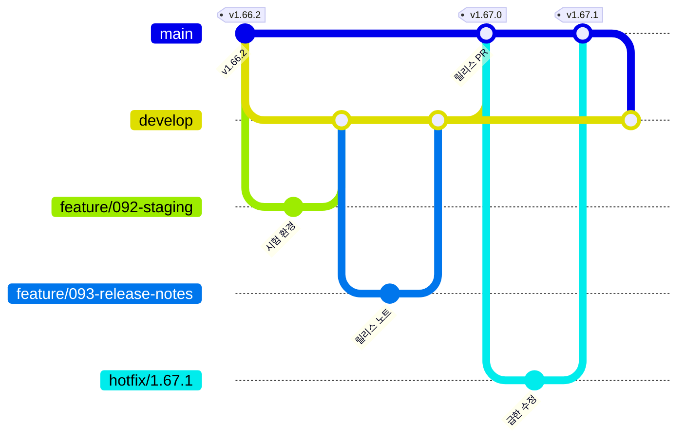

# 브랜치 전략과 릴리스 절차

devlog는 2026-10-12부터 **목표 단위 Git Flow**로 개발하고 릴리스한다.
그 전에는 PR 하나마다 main에 머지하고 버전을 올렸다(v1.0.0~v1.66.2). 버전 숫자만으로는 무엇을 이뤘는지 알 수 없어서, 버전마다 목표를 먼저 세우고 목표를 다 채웠을 때 한 번에 릴리스하는 방식으로 바꿨다.

## 한눈에 보기

| 브랜치 | 어디서 만드나 | 어디로 합치나 | 버전 | 배포 |
|---|---|---|---|---|
| `main` | - | - | 릴리스할 때만 올림 | 운영(devlog.life) 배포 + 태그 |
| `develop` | `main` | `main`(릴리스 PR) | 올리지 않음 | 시험 환경(dev.devlog.life, 변수 `STAGING_ENABLED=true`일 때). PR·푸시마다 테스트 |
| `feature/<spec번호>-<이름>` | `develop` | `develop` | 올리지 않음 | 없음 |
| `hotfix/<버전>` | `main` | `main`, 그다음 `develop` | Patch | 운영 배포 |

Claude 스레드가 작업할 때는 실행 환경이 정한 `claude/...` 브랜치 이름을 써도 된다. 이때도 **PR의 base는 `develop`** 이고, PR 본문에 어느 목표(마일스톤) 이슈인지 적는다.

## 1. 목표 세우기

1. 다음 마이너 버전의 목표를 하나 정한다. 예: "v1.67.0 배포 신뢰도와 릴리스 기록".
2. GitHub 마일스톤 `v1.67.0`을 만들고 설명에 목표 한 문단과 "다 됐다"의 기준을 적는다.
3. 할 일은 그 마일스톤에 묶인 이슈로 만든다. 이슈 하나가 feature 브랜치 하나, PR 하나가 되도록 나눈다.
4. 목표 이슈(제목이 `[목표] v1.67.0 …`)를 하나 두고 할 일 이슈를 하위 이슈로 단다. 마일스톤을 쓸 수 없는 도구에서도 목표 이슈와 `목표: v1.67.0` 라벨로 같은 묶음을 볼 수 있다.

목표에 없는 일이 생기면 다음 마일스톤에 넣는다. 목표를 바꿔야 하면 마일스톤 설명과 목표 이슈를 함께 고치고 이유를 적는다.

## 2. 기능 개발 (feature → develop)

1. `develop`에서 브랜치를 딴다: `git switch -c feature/092-staging origin/develop`.
2. 작업하고 PR을 **`develop`으로** 연다. 본문에 `Closes #이슈번호`를 적는다.
3. PR에서 백엔드 테스트(backend-ci), 화면 CI, README 검사, 매니페스트 검증·이미지 빌드(올리지는 않음)가 돈다.
4. 모두 초록이면 squash 머지한다. **버전 숫자(pom.xml·package.json)는 올리지 않는다.**
5. `CHANGELOG.md`의 `## [Unreleased]` 아래 알맞은 구획(추가·바꿈·고침·화면)에 한 줄을 더한다. 화면이 바뀌었으면 전/후 사진을 `assets/releases/unreleased/`에 넣는다.
6. develop에 푸시되면 테스트가 한 번 더 돈다. 운영에는 배포하지 않고, 변수 `STAGING_ENABLED=true`일 때만 시험 환경(dev.devlog.life)에 배포한다.

여러 작업이 동시에 develop에 머지되므로 머지 직전에 develop을 받아 충돌을 풀고 테스트를 다시 확인한다.

## 3. 릴리스 (develop → main)

마일스톤의 할 일 이슈가 모두 닫히면, **마지막 작업을 머지한 사람(스레드)** 이 릴리스한다.

1. `develop`에서 `release/1.67.0` 브랜치를 딴다.
2. 버전을 올린다: `app/backend/pom.xml`, `app/frontend/package.json`(+ lock), README 4개 언어의 릴리스 표.
3. `CHANGELOG.md`의 `## [Unreleased]`를 `## [1.67.0] - 날짜`로 바꾸고 [릴리스 노트 틀](.github/RELEASE_TEMPLATE.md)에 맞춰 다듬는다. 새 `## [Unreleased]`를 맨 위에 다시 둔다. 사진은 `assets/releases/unreleased/`에서 `assets/releases/v1.67.0/`으로 옮긴다.
4. PR을 **`main`으로** 연다. 제목은 `릴리스 v1.67.0: <목표>`.
5. 테스트가 초록이면 **merge commit으로** 머지한다(squash하지 않는다. develop과 main의 이력이 어긋나지 않게).
6. main 푸시로 `블로그 배포`가 백엔드·화면 테스트를 다시 돌리고, 둘 다 통과해야 운영에 배포한다. `release`가 태그 `v1.67.0`과 GitHub Release를 만들고, 노트 끝에 이전 태그 뒤로 머지된 PR(번호·제목·브랜치) 표와 비교 링크를 자동으로 붙인다. 사이트 릴리스 노트(/releases)도 같은 사진을 보여 준다(spec 093).
7. 마일스톤과 목표 이슈를 닫고, 다음 마일스톤을 세운다.

## 4. 급한 수정 (hotfix)

사이트가 깨졌거나 보안 문제일 때만 쓴다. 그 밖의 버그는 다음 마일스톤에 넣는다.

1. `main`에서 `hotfix/1.67.1`을 딴다.
2. 고치고 Patch 버전을 올리고 CHANGELOG에 `## [1.67.1]`을 쓴다.
3. PR을 `main`으로 열어 테스트가 초록이면 머지한다. 운영에 배포되고 태그가 붙는다.
4. 바로 `main`을 `develop`에 합친다(merge commit). 충돌이 나면 develop 쪽을 살려 푼다.

## 5. 버전과 문서 PR

- Semantic Versioning을 따른다. 목표 릴리스는 Minor, hotfix는 Patch, API·스키마 호환이 깨지면 Major.
- README·CHANGELOG·specs·문서만 바꾸는 PR은 버전을 올리지 않는다. `develop`으로 머지하고 다음 릴리스에 함께 나간다.
- 버전 숫자는 릴리스 PR과 hotfix PR에서만 바뀐다. 그래서 develop에는 언제나 직전 릴리스 버전이 적혀 있다.

## 6. CI·배포가 도는 곳

| 워크플로 | PR(어느 base든) | develop 푸시 | main 푸시 |
|---|---|---|---|
| backend-ci | 테스트 | 테스트 | 블로그 배포 안에서 테스트 |
| 화면 CI | 테스트 | 테스트 | 블로그 배포 안에서 테스트 |
| readme-check | 검사 | 검사 | 검사 |
| 블로그 배포 | 매니페스트 검증·이미지 빌드 | `STAGING_ENABLED=true`면 시험 환경 배포, 아니면 돌지 않음 | 테스트 → 이미지 → **테스트가 통과해야** 배포 |
| release | - | - | CHANGELOG 맨 위 버전으로 태그·릴리스 |

## 7. 되돌리기

- 배포가 헬스 체크를 통과하지 못하면 `deploy/scripts/rollout.sh`가 직전 버전으로 자동 롤백한다.
- 배포는 됐는데 기능이 이상하면 직전 태그(`vX.Y.Z`)의 이미지로 되돌리고 hotfix로 고친다. 모든 릴리스에 태그와 GHCR 이미지가 남아 있다.
- `develop`은 언제나 다음 릴리스 후보라서, main이 망가져도 develop과 태그 두 곳에 성한 코드가 있다.
